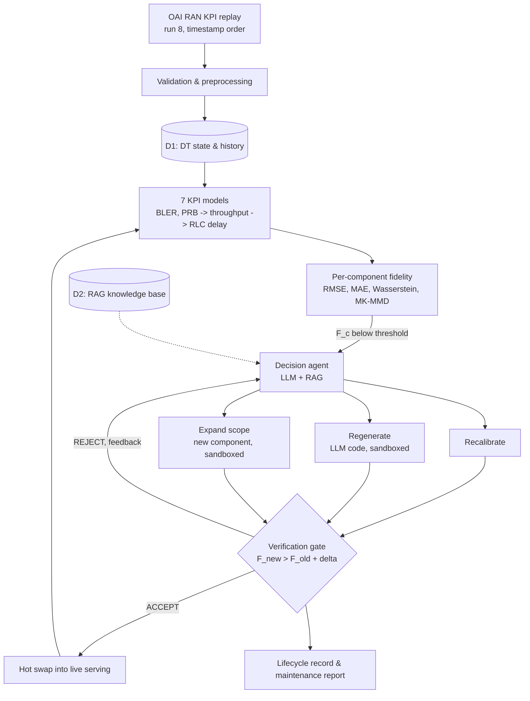
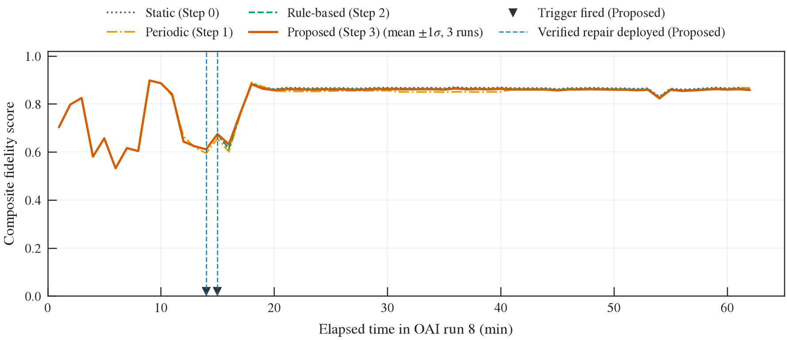

# AI-Driven Self-Adaptive Digital Twin for a 5G OAI RAN

A digital twin (DT) of a real 5G RAN testbed (OpenAirInterface, OAI) that keeps itself accurate.
It replays recorded OAI KPI telemetry, predicts 7 RAN KPIs, measures its own fidelity, and when a
component drifts, repairs it. An LLM agent decides how to repair; a deterministic gate decides
whether the repair is deployed.



(`fig-dataflow.png` is the original NS-3-era design diagram, kept for history.)

## What it does

| Stage | What happens | Code |
|---|---|---|
| Telemetry | Real OAI KPI records replayed in timestamp order (or a mock source) | `src/telemetry/` |
| DT state (D1) | Continuously synchronized current + historical state | `src/synchronization/`, `src/dt_models/d1_model_store.py` |
| Prediction | 7 dependency-aware KPI models: `dl_bler`, `ul_bler`, `dl_prb`, `ul_prb` → `dl_throughput`, `ul_throughput` → `dl_rlc_delay` | `src/dt_models/` |
| Fidelity | Deterministic per-component score from RMSE, MAE, Wasserstein and MK-MMD; a component triggers when its score stays below threshold | `src/fidelity/` |
| Decision | LLM + RAG agent (Gemini) explains the root cause and picks **recalibrate**, **regenerate** or **expand scope** | `src/adaptation/decision_agent.py`, `src/rag/` |
| Repair | Retrain, LLM-rewritten model, or LLM-designed new component; generated code runs only in a sandbox | `src/adaptation/*_agent.py`, `src/sandbox/` |
| Verification | Candidate is deployed only if `F_new > F_old + δ` on held-out data; the LLM can explain but never override | `src/adaptation/verification_agent.py` |
| Deployment | Accepted models are hot-swapped without a restart; every step is logged | `src/main.py`, `src/registry/`, `src/adaptation/lifecycle_agent.py` |

Failed repairs retry with the rejection reason fed back, and several components can be repaired in
parallel. The full design is in [CLAUDE.md](CLAUDE.md); the operator guide is [manual.md](manual.md).

## Quick start

Tested with Python 3.14 on Linux (Ubuntu under WSL); Python ≥ 3.12 is expected to work. A Google
AI (Gemini) API key is optional; without one the system runs with its documented deterministic
fallbacks.

```bash
git clone <this-repo-url> && cd <repo>
python3 -m venv .venv && source .venv/bin/activate
pip install -r requirements-lock.txt   # exact tested versions (or requirements.txt for minimums)
cp .env.example .env              # optional: add GOOGLE_API_KEY for the LLM agents
python scripts/ingest_rag.py      # build the local RAG vector store (~seconds)
python scripts/setup.py           # checks directories, dependencies and config
```

The processed OAI testbed dataset ships with the repository (`data/processed/oai/`: train =
runs 3, 6, 7; test = run 8), so nothing else needs downloading.

## Running

```bash
python -m src.main --mode live --replay-speed 10   # real OAI replay of run 8, 10x real time (Ctrl-C to stop)
python -m src.main --mode demo                     # mock telemetry, same pipeline
python scripts/test_adaptation_agents.py           # each repair agent on its own, on real OAI data
```

| Without an API key | With `GOOGLE_API_KEY` |
|---|---|
| Live/demo loop, fidelity, triggers, recalibration, verification, hot swap all run; the decision agent uses its logged fallback (recalibrate) | Adds LLM decisions, regenerate and expand-scope agents, and LLM explanations |

What the console shows is explained in [manual.md](manual.md) §3.

## Results: the 4-step ablation

Four conditions over the held-out OAI run 8, scored on the same 62 one-minute windows:

| Step | Mode | Adaptation |
|---|---|---|
| 0 | Static | none |
| 1 | Periodic | retrain all models every 10 min of data, deploy unverified |
| 2 | Rule-based | fidelity trigger → severity rule → repair → gate |
| 3 | Proposed | fidelity trigger → LLM + RAG decision → repair → gate (3 runs) |

The modes are compared on one common (frozen) fidelity scale, with Wilcoxon tests, block-bootstrap
95% CIs and Holm correction ([baselines/README.md](baselines/README.md)).

| Mode | Mean windowed fidelity | Proposed − mode (95% CI) |
|---|---|---|
| Static | 0.8196 | −0.0041 [−0.0058, −0.0021] |
| Rule-based | 0.8174 | −0.0018 [−0.0027, −0.0007] |
| **Proposed** | **0.8155** | — |
| Periodic | 0.8122 | +0.0033 [+0.0012, +0.0065] |

**Reading the result honestly:**

- **Differences are tiny.** All are under 0.006.
- **Proposed beats periodic** retraining, using about 3% of its compute.
- **Proposed does not beat static or rule-based on run 8.** Run 8 carries traffic only in its first ~18 minutes, so 44 of 62 windows are idle and every trigger fired at minutes 14–15. Run 8 alone cannot demonstrate a benefit from adaptation.

Details, and the options for a stronger test, are in
[IMPLEMENTATION_STATUS.md](IMPLEMENTATION_STATUS.md) item 16.



All figures are in [figures/](figures/) as PDF, PNG and CSV. The raw per-run outputs are in
[baselines/results/](baselines/results/): events, timelines, statistics, graphs, run logs, and the
model versions each run produced.

### Reproducing the results

```bash
python baselines/run_all.py              # all 4 modes on run 8 (~2-3 h; LLM modes need GOOGLE_API_KEY, ~$0.05)
python baselines/stats.py                # frozen-scale scores + statistics -> baselines/results/stats/
python scripts/generate_ieee_figures.py  # the 7 figures -> figures/
```

Static and periodic need no API key: `python baselines/run_all.py --modes static periodic_retrain --skip-preflight`.

## Tests

```bash
pytest tests/unit          # ~580 tests, ~15 min
pytest tests/integration   # real-pipeline tests on the OAI data
pytest tests/e2e
```

One unit test calls the live Gemini API when a key is configured, and skips otherwise. Run the
suites separately; one combined run can exhaust memory on small machines.

## Repository layout

```
config/settings.yaml   every tunable parameter (no magic constants in code)
src/                   the system (module map in CLAUDE.md §2)
baselines/             ablation harness, statistics, and committed results
scripts/               dataset build, RAG ingest, agent tests, figures, demos
data/processed/oai/    processed OAI testbed dataset (committed)
figures/               the 7 evaluation figures
rag_data/              RAG corpus (O-RAN docs, DT docs, policies, history)
docs/                  model reference, OAI KPI catalog, how-to-run
tests/                 unit / integration / e2e
archive/               retired NS-3/5G-LENA code (history only)
```

## Rebuilding the dataset from raw OAI CSVs

This is only needed with a raw OAI export. Set `OAI_ROOT=/path/to/rankpi_kpi` in `.env`, then run
`python scripts/build_oai_dataset.py`. See [docs/oai_twin.md](docs/oai_twin.md) for the KPI
catalog and split design.

## License

[MIT](LICENSE). The OAI testbed data in `data/processed/oai/` is published with the code under the
same terms.
