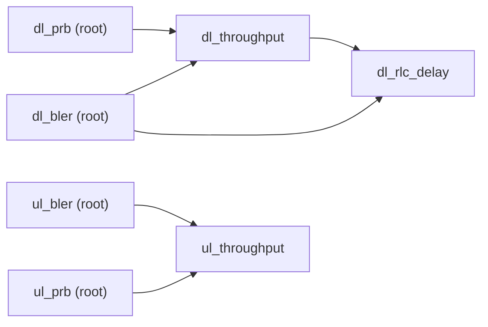

# DT Prediction Components — Model Reference

Authoritative per-component reference for the 7 real OAI KPI prediction components
(`src/dt_models/{dl_bler,ul_bler,dl_prb,ul_prb,dl_throughput,ul_throughput,dl_rlc_delay}.py`),
current as of `claude_code_prompt_phase13.md`'s model fix (§1). All 7 are
`ResidualDTComponent` subclasses (`src/dt_models/residual_base.py`): each one is trained on the
one-second RESIDUAL `Δy = y_t − y_{t−1}` rather than the raw level, and `predict()` reconstructs
`ŷ_t = y_{t−1} + Δŷ` — the public `predict()` interface is unchanged; only what the regressor is
fit against differs. Every number in the "Results" section below is copied verbatim from
`reports/model_eval/model_eval.csv` (the real leave-one-run-out CV run over the real TRAIN/TUNE
pool, runs 3/6/7) — never retyped or recomputed by hand.

## Dependency graph

All 4 roots (`dl_bler`, `ul_bler`, `dl_prb`, `ul_prb`) are independent and use only lagged
telemetry features. `dl_throughput`/`ul_throughput` each additionally consume their own
direction's upstream BLER+PRB prediction (ground truth at train time, the live upstream
prediction at serve time — Modules 6-10's established convention). `dl_rlc_delay` additionally
consumes `dl_throughput` + `dl_bler`.

---

## dl_bler

**Purpose.** Predicts the downlink MAC-layer block-error rate for the next second — a direct
radio-link-quality signal (how often downlink transport blocks fail CRC and need
retransmission), independent of any scheduling or traffic-volume effect.

**Target KPI.** O-RAN name `DL block error rate` (not a named `dim_kpm_meas_name` entry — read
directly from `mac_ue_1s.dl_bler_avg`). Display unit: **ratio, 0-1** (same as raw — no
conversion). OAI source: `mac_ue_1s.csv`, column `dl_bler_avg`.

**Inputs.** `src.data.oai_dataset.ALL_FEATURES` (249 columns) — lag-1..5 and 5s/10s rolling
mean+std of: the 7 raw targets themselves (own history is directly informative for a residual
model) and the 10 MAC-layer features (`dl_curr_tbs`, `dl_sched_rb`, `pusch_snr`, `pucch_snr`,
`wb_cqi`, `dl_mcs1`, `ul_mcs1`, `phr`, `dl_bler`, `ul_bler`) — plus 6 lag-1-only context columns
(`bsr_avg`, `n_samples`, per-cell/per-slice UE counts, requested PRB ratio, `has_controller`).
The MAC features are relevant because channel quality (`wb_cqi`, `pusch_snr`/`pucch_snr`) and
scheduler aggressiveness (`dl_mcs1`, `dl_sched_rb`) are the direct physical drivers of block
error; the rolling stats capture recent trend/volatility a single lag cannot.

**ML model.** XGBoost, residual target. Final hyperparameters (leave-one-run-out CV winner,
re-fit on the full train pool): `n_estimators=300, max_depth=5, learning_rate=0.03, subsample=0.8`.
Chosen over the shallower `{150, 4, 0.05}` candidate because it scored lower average CV RMSE for
this component specifically — each of the 7 components tunes independently.

**Dependencies.** None — a root component.

**Results** (leave-one-run-out CV, train/tune pool runs {3,6,7}; copied from `model_eval.csv`):

| held-out run | model RMSE | model MAE | persistence RMSE | persistence MAE | MA(5s) RMSE | MA(5s) MAE | beats persistence |
|---|---|---|---|---|---|---|---|
| 3 | 0.0098 | 0.0041 | 0.0112 | 0.0043 | 0.0194 | 0.0070 | yes |
| 6 | 0.0081 | 0.0028 | 0.0086 | 0.0026 | 0.0142 | 0.0040 | yes |
| 7 | 0.0146 | 0.0085 | 0.0152 | 0.0077 | 0.0242 | 0.0115 | yes |
| **avg** | **0.0108** | **0.0052** | **0.0117** | **0.0049** | **0.0193** | **0.0075** | **3/3 folds** |

**Limitations.** This is radio-link BLER, not end-to-end packet loss — a retransmitted block
that eventually succeeds at the RLC layer never shows up as "loss" anywhere else in this DT.
Trained on only 3 runs from one testbed deployment; generalization to a different cell/UE
population or RF environment is untested.

---

## ul_bler

**Purpose.** Same role as `dl_bler`, for the uplink direction.

**Target KPI.** `mac_ue_1s.ul_bler_avg`. Display unit: ratio, 0-1 (no conversion).

**Inputs.** Identical 249-column `ALL_FEATURES` set as `dl_bler` (same rationale) — the model
itself learns which of the downlink/uplink-specific features matter for this direction.

**ML model.** XGBoost, residual target. Final hyperparameters: `n_estimators=150, max_depth=4,
learning_rate=0.05, subsample=0.8` — the shallower candidate won for this component (its
residual signal is smaller-magnitude/noisier than `dl_bler`'s, and the deeper candidate
overfit it in CV, the same overfitting pattern Module 10's original `jitter` component hit in
Phase 12 — see `CLAUDE.md`'s Module 10 entry).

**Dependencies.** None — a root component.

**Results:**

| held-out run | model RMSE | model MAE | persistence RMSE | persistence MAE | MA(5s) RMSE | MA(5s) MAE | beats persistence |
|---|---|---|---|---|---|---|---|
| 3 | 0.0056 | 0.0021 | 0.0072 | 0.0027 | 0.0095 | 0.0037 | yes |
| 6 | 0.0047 | 0.0014 | 0.0059 | 0.0018 | 0.0078 | 0.0025 | yes |
| 7 | 0.0080 | 0.0043 | 0.0094 | 0.0049 | 0.0122 | 0.0065 | yes |
| **avg** | **0.0061** | **0.0026** | **0.0075** | **0.0032** | **0.0098** | **0.0042** | **3/3 folds** |

**Limitations.** Same as `dl_bler` (radio-link only, 3-run training population) — uplink BLER
also depends on UE transmit power/PHR, which is a feature here but not independently verified
for correctness against the testbed's real RF conditions.

---

## dl_prb

**Purpose.** Predicts downlink PRB (physical resource block) consumption for the next second —
a radio resource-utilization signal, not a throughput or quality signal.

**Target KPI.** `RRU.PrbTotDl` per UE. Display unit: PRBs/second (raw count, no conversion).
OAI source: `v_ue_kpm_1s` view (primary); `mac_ue_1s.dl_aggr_prb` delta is the documented
fallback when `v_ue_kpm_1s` lacks a row (see `docs/oai_twin.md` §2-3) — not exercised in this
dataset build, which had full `v_ue_kpm_1s` coverage.

**Inputs.** The same 249-column `ALL_FEATURES` set. `dl_sched_rb`/`dl_mcs1`/`wb_cqi` are the
most directly relevant group (scheduler's actual RB allocation and the channel quality driving
it); the requested-PRB-ratio controller feature is relevant because this OAI deployment's RAN
Intelligent Controller can reserve a fraction of PRBs per slice.

**ML model.** XGBoost, residual target. Final hyperparameters: `n_estimators=300, max_depth=5,
learning_rate=0.03, subsample=0.8`.

**Dependencies.** None — a root component.

**Results:**

| held-out run | model RMSE | model MAE | persistence RMSE | persistence MAE | MA(5s) RMSE | MA(5s) MAE | beats persistence |
|---|---|---|---|---|---|---|---|
| 3 | 13.9414 | 4.9448 | 15.8307 | 4.7493 | 20.6485 | 6.9349 | yes |
| 6 | 14.1114 | 3.9527 | 14.3754 | 3.6181 | 18.4845 | 4.9651 | yes |
| 7 | 20.6129 | 9.0402 | 20.3775 | 8.0968 | 24.6883 | 10.5566 | **no** |
| **avg** | **16.2219** | **5.9792** | **16.8612** | **5.4881** | **21.2737** | **7.4855** | **2/3 folds** |

**Limitations.** Honestly reported: this component does NOT beat persistence on held-out run 7
— PRB allocation on that run has a step-change pattern (likely a controller policy change
mid-run) a lag/rolling-feature model cannot anticipate one second ahead. Reported as a real
finding, not hidden or re-tuned away (phase13 §1.5's own explicit instruction).

---

## ul_prb

**Purpose.** Same role as `dl_prb`, uplink direction.

**Target KPI.** `RRU.PrbTotUl` per UE. Display unit: PRBs/second.

**Inputs.** Same 249-column set.

**ML model.** XGBoost, residual target. Final hyperparameters: `n_estimators=150, max_depth=4,
learning_rate=0.05, subsample=0.8`.

**Dependencies.** None — a root component.

**Results:**

| held-out run | model RMSE | model MAE | persistence RMSE | persistence MAE | MA(5s) RMSE | MA(5s) MAE | beats persistence |
|---|---|---|---|---|---|---|---|
| 3 | 2.1791 | 0.3671 | 2.2627 | 0.3345 | 3.4299 | 0.5375 | yes |
| 6 | 1.9770 | 0.3191 | 2.0186 | 0.2866 | 2.9531 | 0.4397 | yes |
| 7 | 1.3008 | 0.3904 | 1.3597 | 0.3851 | 1.8984 | 0.5109 | yes |
| **avg** | **1.8190** | **0.3589** | **1.8804** | **0.3354** | **2.7605** | **0.4960** | **3/3 folds** |

**Limitations.** Uplink PRB allocation is more directly demand-driven (UL grant per BSR) than
downlink in this scheduler, which may explain why this one generalizes better than `dl_prb`
across all 3 folds — not independently confirmed against OAI scheduler source, just an
observation from the CV pattern.

---

## dl_throughput

**Purpose.** Predicts per-UE downlink RLC/PDCP throughput for the next second — the primary
user-experience KPI this DT exposes.

**Target KPI.** `DRB.UEThpDl`. Display unit: **Mbps** (raw OAI unit is kbps; `÷1000` applied once
in `src/data/oai_dataset.py`'s unit-conversion step — see `docs/oai_twin.md` §2 for the
empirical justification). OAI source: `v_ue_kpm_1s` (primary); `8·Δdl_aggr_tbs/Δt/1e6` from
`mac_ue_1s` (documented fallback, not exercised here).

**Inputs.** The 249-column `ALL_FEATURES` set PLUS the live upstream predictions of `dl_bler`
and `dl_prb` (`DL_BLER_INPUT_COLUMN`/`DL_PRB_INPUT_COLUMN` = `dl_bler_pred`/`dl_prb_pred`) — at
training time populated from the real ground-truth `dl_bler`/`dl_prb` columns (the strongest
available training signal); at serve time, from the orchestrator's own live upstream
predictions. Relevant because throughput is mechanically `≈ PRBs allocated × spectral
efficiency, derated by BLER` — these two upstream KPIs are the direct physical drivers.

**ML model.** XGBoost, residual target. Final hyperparameters: `n_estimators=150, max_depth=4,
learning_rate=0.05, subsample=0.8`.

**Dependencies.** `dl_bler`, `dl_prb` — both roots, both already described above.

**Results:**

| held-out run | model RMSE | model MAE | persistence RMSE | persistence MAE | MA(5s) RMSE | MA(5s) MAE | beats persistence |
|---|---|---|---|---|---|---|---|
| 3 | 0.1255 | 0.0259 | 0.1935 | 0.0550 | 0.2486 | 0.0825 | yes |
| 6 | 0.6320 | 0.0894 | 0.4833 | 0.0779 | 0.7675 | 0.1307 | **no** |
| 7 | 0.2323 | 0.0396 | 0.3466 | 0.1011 | 0.4883 | 0.1427 | yes |
| **avg** | **0.3299** | **0.0516** | **0.3411** | **0.0780** | **0.5015** | **0.1186** | **2/3 folds** |

**Limitations.** Honestly reported: loses to persistence on held-out run 6 specifically — this
run's throughput trace has the largest second-to-second swings of the 3 training runs (by RMSE
magnitude, ~2-5x the other two), where a lag/rolling model trained on the other two
(comparatively calmer) runs under-reacts. Measures RLC/PDCP throughput at the RAN, not
end-to-end application throughput (no TCP/application-layer effects modeled).

---

## ul_throughput

**Purpose.** Same role as `dl_throughput`, uplink.

**Target KPI.** `DRB.UEThpUl`. Display unit: **Mbps** (same kbps→Mbps conversion).

**Inputs.** `ALL_FEATURES` plus the live `ul_bler`/`ul_prb` predictions
(`UL_BLER_INPUT_COLUMN`/`UL_PRB_INPUT_COLUMN`), same rationale as `dl_throughput`.

**ML model.** XGBoost, residual target. Final hyperparameters: `n_estimators=300, max_depth=5,
learning_rate=0.03, subsample=0.8`.

**Dependencies.** `ul_bler`, `ul_prb`.

**Results:**

| held-out run | model RMSE | model MAE | persistence RMSE | persistence MAE | MA(5s) RMSE | MA(5s) MAE | beats persistence |
|---|---|---|---|---|---|---|---|
| 3 | 0.0312 | 0.0030 | 0.0361 | 0.0048 | 0.0610 | 0.0090 | yes |
| 6 | 0.0302 | 0.0034 | 0.0330 | 0.0044 | 0.0550 | 0.0077 | yes |
| 7 | 0.0186 | 0.0036 | 0.0225 | 0.0064 | 0.0338 | 0.0090 | yes |
| **avg** | **0.0267** | **0.0033** | **0.0305** | **0.0052** | **0.0499** | **0.0086** | **3/3 folds** |

**Limitations.** UL throughput in this deployment is small in absolute magnitude relative to DL
(asymmetric traffic profile in the testbed's own workload) — low absolute error here is
partially a function of a generally low/stable UL demand, not necessarily a harder-won result
than `dl_throughput`'s.

---

## dl_rlc_delay

**Purpose.** Predicts downlink RLC SDU queueing/transmission delay — a latency signal at the RAN
RLC layer.

**Target KPI.** `DRB.RlcSduDelayDl` (not actually present as a column in the real export's
`v_ue_kpm_1s` view — see `docs/oai_twin.md` §2). Display unit: **ms** (raw OAI source is
`rlc_bearer_1s.tx_sdu_avg_time_to_tx_avg`, in **microseconds**; `÷1000` applied once in
`src/data/oai_dataset.py`). There is no documented fallback source for this KPI in this export.

**Inputs.** `ALL_FEATURES` plus the live `dl_throughput`/`dl_bler` predictions
(`DL_THROUGHPUT_INPUT_COLUMN`/`DL_BLER_INPUT_COLUMN`) — relevant because RLC queueing delay
mechanically increases when throughput drops relative to offered load (backlog grows) and when
BLER-driven retransmissions hold a PDU in the RLC window longer.

**ML model.** XGBoost, residual target. Final hyperparameters: `n_estimators=150, max_depth=4,
learning_rate=0.05, subsample=0.8`.

**Dependencies.** `dl_throughput`, `dl_bler` — the only one of the 7 components with a
two-level-deep dependency chain (depends on a component that itself has dependencies).

**Results:**

| held-out run | model RMSE | model MAE | persistence RMSE | persistence MAE | MA(5s) RMSE | MA(5s) MAE | beats persistence |
|---|---|---|---|---|---|---|---|
| 3 | 10.1366 | 1.7197 | 11.9148 | 1.2119 | 9.1556 | 1.2096 | yes |
| 6 | 7.1072 | 1.1556 | 7.5677 | 0.5771 | 5.8532 | 0.5773 | yes |
| 7 | 15.9520 | 3.9150 | 19.9140 | 2.8020 | 15.5659 | 2.8468 | yes |
| **avg** | **11.0653** | **2.2634** | **13.1322** | **1.5303** | **10.1916** | **1.5446** | **3/3 folds** |

**Limitations.** This is RLC-layer queueing/transmission delay, NOT end-to-end application
latency — no core-network, transport, or application-layer delay is represented anywhere in
this DT. Despite beating RMSE-based persistence on all 3 folds, its MAE is consistently WORSE
than both persistence and the moving average (e.g. fold 6: MAE 1.1556 vs persistence's 0.5771) —
RMSE rewards avoiding large misses (which this model does, likely by smoothing), at the cost of
a worse typical-case error than simply assuming "no change." Reported honestly rather than
cited selectively.

---

## KPIs available but not modelled (expand-scope candidates)

The real OAI export contains several more KPIs this DT's 7 core components do not predict — real
candidates for a future Expand-Scope Agent (Module 16) run, not fabricated placeholders:

- **`DRB.PdcpSduVolumeDL`/`UL`** (PDCP SDU volume, kb, cumulative) — the TRUE payload delivered,
  unlike `mac_ue.dl_aggr_tbs` which includes scheduling padding; a PDCP-volume-rate component
  would be a genuinely different (more application-relevant) throughput signal than
  `dl_throughput`'s RLC/PDCP-layer-but-TBS-derived one.
- **`qos_flow_mapping`** (the only other control action this OAI build actually implements,
  besides `dedicated_prb_ratio`) — not currently used as a feature or target anywhere.
- **Uplink SNR asymmetry** — `pusch_snr`/`pucch_snr` are consumed as INPUT features by all 7
  components, but nothing in this DT predicts channel quality itself (e.g. a `wb_cqi` or
  `pusch_snr` forecasting component), which would be a genuinely new "phenomenon the current DT
  does not represent" in prompt.md §27's sense — concretely demonstrated as feasible by this
  project's own `scripts/demo_expand_scope.py` run, which (in its Phase-12-era NS-3 context)
  proposed and implemented exactly this kind of signal-quality-prediction component end to end.
